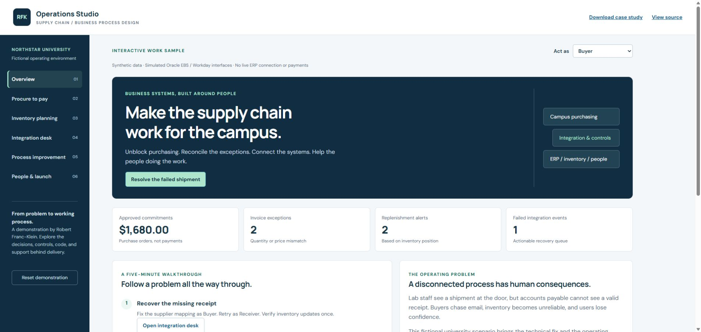
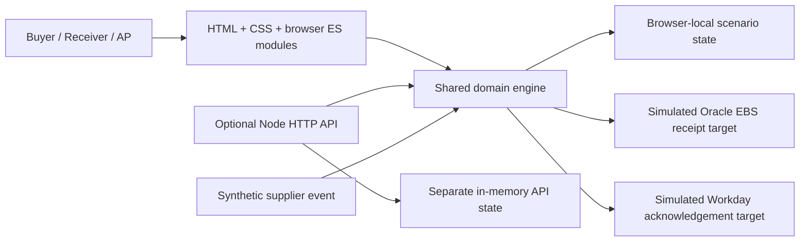

# Supply Chain Operations Studio

A working portfolio demonstration by **Robert Franc-Klein**: identify an operating problem, implement the software and integration controls, and help people adopt a sustainable process.

## Review the work

- [Interactive demo](https://storage.googleapis.com/raf-business-app-portfolio-757561763135/scm-studio/index.html)
- [Download the standalone case study](SCM_Case_Study.pdf)
- [Detailed case study](../../case-studies/supply-chain-operations-studio.md)
- [API and integration specification](API.md)
- [Synthetic starting dataset](data/demo-seed.json)

**All organizations, suppliers, transactions, metrics and integration events are fictional.** Oracle EBS and Workday adapter targets are simulated; this project does not connect to their production services, reproduce proprietary schemas, or establish prior employer deployments. No payment can be sent.



## Five-minute demonstration

1. Open **Integration desk** as **Buyer**. Validate `SUMMIT-LABS` → `Summit Scientific` against the proposed supplier master.
2. Switch to **Receiver** and retry `EVT-7001`. PO-1041 received quantity changes from 12 to 20; lab inventory changes from 8 to 16; on-order quantity changes from 8 to 0.
3. Retry again: duplicate delivery is rejected without changing balances.
4. Open **Procure to pay**, switch to **Accounts payable**, and match PO-1041. No payment is sent.
5. Attempt to match PO-1043: the price discrepancy holds the invoice. Set the invoice unit price to $72.00 to model receipt of a supplier-corrected invoice, then match. Production correction would require evidence and authorization.
6. Explore **Inventory planning**, **Process improvement**, and **People & launch**. Increasing lab lead time from 5 to 10 days changes the recommendation from 5 to 20 units.
7. In Buyer role, review all five launch gates. Reset returns to the synthetic starting state.

## Run locally

Requires Node.js 20 or newer. No installation or third-party JavaScript dependency is required.

```sh
cd apps/supply-chain-operations-studio
npm start
# Open http://127.0.0.1:4178
npm test
```

`SCM_DEMO_PORT` overrides the default port. The server binds to loopback only.

The static UI also runs on any HTTP static host. Its domain rules execute in the browser and state is stored in `localStorage`. The optional Node API uses the **same domain engine**, but maintains a **separate in-memory state** for API review. The static UI does not call the API. Restarting the API resets its dataset; resetting the UI affects browser state only.

## Architecture



## Decisions demonstrated

- Integer cents for financial calculations; quantity and price matching remain explicit.
- Separate Buyer, Receiver and AP actions, enforced in the shared engine. The selector is an educational control, **not authentication**.
- Failed supplier mapping cannot post inventory; recovery updates the receipt and inventory together.
- Event identities prevent repeated successful delivery within a dataset; failed attempts remain retryable.
- Inventory recommendations include open purchase orders and never trigger procurement automatically.
- One full-order invoice per PO; partial deliveries supported, partial invoicing intentionally out of scope.
- Fixed benchmark trace separate from transactional orders: current `[6,8,7,9,5]`, proposed `[4,5,5,6,3]` business days. The 34.3% difference is a simulation, not a realized result.
- Owner-led acceptance, realistic training, fear resolution, cutover evidence, hypercare and ongoing optimization are part of delivery.

## Verification

Automated Node tests exercise invoice holds, partial-delivery invariants, wrong supplier mappings, duplicate replay, roles, inventory calculations and the HTTP API. The browser walkthrough checks actual controls, role switching, recovery evidence, matching, planning and readiness gates.

## Production boundaries

Before production: real identity and role authorization; persistent transactional storage; durable idempotency keys; immutable audit evidence; currency/tax and tolerance rules; multiple invoices, returns and cancellations; tenant-specific ERP adapters; secrets management; observability; backup/recovery; accessibility and load testing. The demo API is a local development tool, not a production service.

Optional Google Fonts load for presentation; system fonts remain usable without them. No analytics, tracking SDKs, external API requests or private employer data are included.
